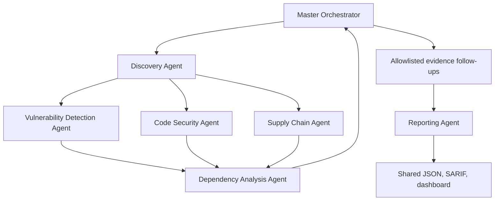

# Multi-agent vulnerability detection

The master orchestrator coordinates six specialists through a shared JSON state.
Evidence collection is deterministic. Groq reviews the collected evidence using
`openai/gpt-oss-120b`; it cannot execute commands or create advisory matches.



## Run

Python 3.11+ is required. From the repository root:

```powershell
python -m pip install -r requirements.txt
python scripts/install_detection_tools.py
python -m agents.detect --target "path/to/juice-shop" --discovery-dir "path/to/discovery-output" --output outputs/detection/juice-shop --api-key-stdin
```

First generate discovery artifacts using the [standalone scanner](../../guardian_scanner/README.md).
The discovery directory must contain `dependency-graph.json`, `source-analysis.json`
and `cyclonedx-sbom.json`; the workflow BOM is optional. Discovery checks the source
target and recorded hashes of manifests, lockfiles and workflows before detection.
The existing `agents.discover` inventory has a different schema and is not accepted
directly by this command.

`--api-key-stdin` uses a hidden credential prompt. `GROQ_API_KEY` is also supported.
Credentials stay in process memory and are removed from scanner child environments.
Provider error bodies and headers are not persisted. Never put keys in command
arguments or committed files. Repository content is treated as untrusted model input;
bounded finding evidence, which can include source snippets, is sent to Groq when
reviews are enabled. Use `--no-llm` to avoid sending evidence to a model provider.

Optional arguments:

| Argument | Behavior |
| --- | --- |
| `--no-llm` | Run collectors without Groq reviews |
| `--model ID` | Override the Groq model |
| `--resume-llm` | Retry missing specialist reviews from saved state without repeating scans |
| `--max-registry-packages N` | Bound registry metadata inspections; default 200, maximum 2000 |
| `--baseline FILE` | Diff a comparable prior CycloneDX SBOM and correlate new dependencies |
| `--image REF` | Request a Trivy image vulnerability scan without executing the image |

The Windows installer downloads pinned Trivy 0.76.2 and OSV-Scanner 2.7.1 and
verifies official release checksums. On other systems install their official CLIs
on PATH. Bandit and zizmor are pinned Python requirements. Optional Semgrep must
be installed separately. OSV API collection works independently of scanner CLIs.

## Checks and evidence

| Specialist | Implemented checks | Limits |
| --- | --- | --- |
| Discovery | Inventory integrity, target identity, manifest/lock/workflow hashes | Reuse a matching discovery snapshot |
| Vulnerability Detection | Exact versioned PURL queries to OSV, full advisory retrieval, pagination; Trivy SBOM and OSV-Scanner adapters | Both tools can detect direct and transitive packages; NVD is not queried independently |
| Code Security | Bounded JS/TS/Python patterns, Bandit; optional Semgrep | Patterns are potential findings; reference snippets and test fixtures are labeled |
| Supply Chain | Name similarity, bounded npm registry metadata, install-hook patterns, workflow permissions/pins/interpolation, zizmor adapter, Scorecard API, optional image scan and SBOM drift | Similarity is not proof of typosquatting; registry 404 is not proof of slopsquatting; no package archive malware scan or install-script sandbox |
| Dependency Analysis | Cycle-safe project paths, direct/transitive classification, import evidence, drift correlation | Imports do not establish vulnerable-function reachability; no findings are suppressed using imports |
| Reporting | Alias deduplication per package, severity/category/scope counts, SARIF and HTML | Blocked/unavailable checks remain explicit gaps |

Groq reviews each specialist's evidence and the master reviews coverage gaps.
Follow-ups are restricted to known package IDs and two read-only operations:
`dependency_path` and `source_import_context`. Arbitrary model instructions are
rejected. Groq review failures do not erase scanner results; missing specialist
reviews can be retried with the same paths and `--resume-llm`.

OSV provides advisories from participating databases, including GHSA records. Advisory
aliases are merged for each affected package while tool provenance is retained.
One advisory affecting several versions can produce several package–advisory matches;
the finding total is not a count of distinct CVEs.

Registry inspection prioritizes direct dependencies and name candidates. Uninspected
packages remain a coverage gap. Download counts, package age, maintainer takeover,
and dynamic sandbox behavior are not inferred. Dependency confusion is explicitly
deprioritized for this run; namespace scoping alone does not eliminate every risk.
No dependency lifecycle script or workflow step is executed.

## Outputs and measured Juice Shop run

Open `dashboard.html#detection` in the output directory. The light monochrome UI
provides paginated findings, filters, evidence, dependency paths, agent reviews,
communication events, coverage and navigation to the existing dependency graph.
JSON outputs are `workflow-state.json`, `findings.json`, `coverage.json` and
`report.sarif.json`; raw tool/registry/advisory evidence is under `raw/`.

The live run on Juice Shop commit `c9f99228d9d56afb5f5ca7925376292f7fa44b13`
queried 1,657 versioned packages through OSV and inspected 200 registry manifests:

| Result | Count |
| --- | ---: |
| Package–advisory matches | 57 |
| Direct / transitive matches | 21 / 36 |
| Potential source patterns | 31 |
| Source patterns: application / reference snippets / test fixtures | 14 / 15 / 2 |
| CI/CD findings | 20 |

All six specialist Groq reviews succeeded after retrying two rate-limited reviews.
Coverage is **partial**: Windows Application Control blocked Trivy, OSV-Scanner and
zizmor executables; OSV HTTPS queries and Bandit ran. Semgrep was unavailable and
Scorecard could not be reached. No container image or comparable prior baseline
was supplied, so those optional checks did not run. These are environment results,
not claims that the blocked tools passed.

Run the detection contract tests with:

```powershell
python -m pytest tests/test_detection.py -q
```
